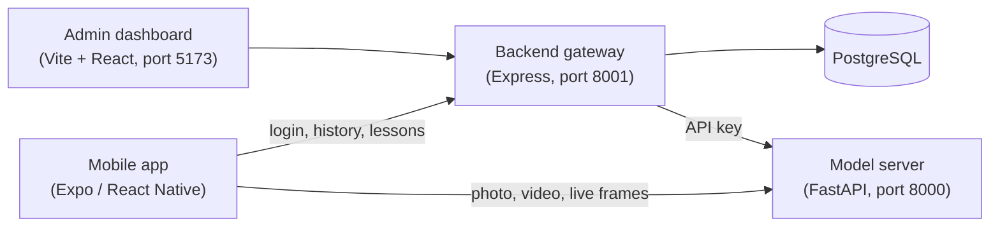

# SignLens

**Real-time sign language fingerspelling recognition, with a gamified learning app.**

Point a phone camera at a hand and SignLens recognises the letter or number being signed, in a photo, an uploaded video, or a live camera stream. A mobile app combines this with lessons and quizzes for learning to sign, and an admin dashboard manages users and course content.

SignLens is a final-year research project at AAMUSTED, Kumasi, Ghana. The current models recognise the **American Sign Language (ASL) manual alphabet**, which Ghanaian Sign Language (GSL) fingerspelling is strongly based on. Extending the data to GSL signers is ongoing work.

---

## Results

The recogniser was rebuilt in October 2026 (see [`AUDIT.md`](AUDIT.md) for why the first version failed). It is evaluated **on people and datasets it never saw during training**, which is how it performs for a new user.

| Test | Accuracy |
|---|---|
| Unseen recordings (same people as in training) | **97.7%** |
| **Completely new person or dataset** (mean of 5 sources) | **82.5%** |
| The first version of the model, on a new signer | 6–17% |

Accuracy on each unseen source:

| Held-out source | Accuracy |
|---|---|
| ASL Alphabet Test (several people, real backgrounds) | 90.2% |
| YouTube signer | 87.8% |
| ASL Alphabet (Kaggle) | 80.2% |
| Synthetic ASL Alphabet | 79.2% |
| Webcam recordings | 75.2% |

These figures cover the 24 letters that are held still (all except J and Z). The hardest letters are the closed-fist group (A, E, M, N, S, T), which differ only in where the thumb sits, and the pairs R/U, K/V and G/P.

---

## How it works



**Recognising a sign:**

1. **Find the hand.** [MediaPipe](https://ai.google.dev/edge/mediapipe/solutions/vision/hand_landmarker) marks 21 points on the hand (wrist, knuckles, fingertips).
2. **Describe its shape.** The points are centred on the wrist, scaled to the palm size, and left hands are mirrored. Backgrounds, lighting, skin tone, and where the hand is in the picture therefore don't matter. This gives 105 numbers per hand: finger positions, joint angles and fingertip distances.
3. **Recognise it.**
   - **Static model:** a small neural network for letters held still. A separate model handles numbers, because in ASL some letters and numbers share a handshape (O/0, V/2, W/6, F/9).
   - **Motion model:** watches about 1.5 seconds of movement for J and Z, and is only used when the hand actually moves.
   - **Live smoothing:** on the live camera, answers are steadied over a few frames so they don't flicker.

---

## Repository layout

| Folder | What it is |
|---|---|
| [`frontend/`](frontend/) | Mobile app: camera sign scanner, text/voice to sign, gamified lessons (Expo SDK 54) |
| [`backend/`](backend/) | API gateway: accounts (JWT), history, lesson content (Express + PostgreSQL) |
| [`admin/`](admin/) | Admin dashboard: analytics, users, courses, logs (Vite + React) |
| [`model/model_endpoints/`](model/model_endpoints/) | Model server that recognises signs (FastAPI + MediaPipe + TFLite) |
| [`model/model_endpoints/saved_models_v2/`](model/model_endpoints/saved_models_v2/) | The trained models used by the server |
| [`notebooks/`](notebooks/) | Training pipeline, runs on Google Colab ([guide](notebooks/README.md)) |
| [`AUDIT.md`](AUDIT.md) | Audit of the first version: why it failed, with evidence |
| `model/` (other folders), `old/` | First-version training scripts and datasets, kept for reference |

---

## Running SignLens on your computer

You need four programs running at the same time: the model server, the backend, the admin dashboard and the mobile app. Open a separate terminal for each.

### What to install first

| Software | Version | Get it |
|---|---|---|
| Node.js | 18 or 20 LTS | [nodejs.org](https://nodejs.org/) |
| Python | 3.11 | [python.org](https://www.python.org/downloads/) (on Windows, tick **"Add python.exe to PATH"**) |
| PostgreSQL | 14 or newer | [postgresql.org](https://www.postgresql.org/download/) |
| Expo Go (on your phone) | latest | Google Play / App Store |

### 1. Create the database

Create an empty PostgreSQL database named `signlens_mobile`, either in pgAdmin or with:

```bash
psql -U postgres -c "CREATE DATABASE signlens_mobile;"
```

### 2. Start the model server (port 8000)

```bash
cd model/model_endpoints
python -m venv venv
venv\Scripts\activate          # Windows
# source venv/bin/activate     # macOS / Linux
pip install -r requirements.txt
uvicorn app.main:app --host 0.0.0.0 --port 8000
```

Open <http://localhost:8000/>. It should show `"status": "ok"` and the modes `letters` and `digits`. The first start downloads MediaPipe's hand model (about 8 MB), so it needs internet once. The interactive API documentation is at <http://localhost:8000/docs>.

### 3. Start the backend (port 8001)

```bash
cd backend
npm install
copy .env.example .env         # Windows  (macOS / Linux: cp .env.example .env)
```

Open `backend/.env` and set at least `PGPASSWORD` (your PostgreSQL password) and `SECRET_KEY` (any long random text). Then:

```bash
npm run migrate
npm run seed
npm run dev
```

The backend API documentation is at <http://localhost:8001/docs>.

### 4. Start the admin dashboard (port 5173)

```bash
cd admin
npm install
npm run dev
```

Open <http://localhost:5173>.

### 5. Start the mobile app

Your phone and computer must be on the **same Wi-Fi network**. Find your computer's IP address (`ipconfig` on Windows, `ifconfig` on macOS/Linux), for example `192.168.1.100`, and put it in `frontend/.env`:

```env
EXPO_PUBLIC_API_URL=http://192.168.1.100:8001/api/v1
EXPO_PUBLIC_ML_API_URL=http://192.168.1.100:8000
```

Then:

```bash
cd frontend
npm install
npx expo start
```

Scan the QR code with Expo Go (Android) or the Camera app (iPhone). Press `w` to open it in a web browser instead.

---

## Model server API

| Request | What it does |
|---|---|
| `POST /api/v1/predict?type=image` | Recognise a sign in a photo (multipart field `file`) |
| `POST /api/v1/predict?type=video` | Recognise a sign in a short video |
| `WS /api/v1/predict-stream?api_key=...&type=stream` | Live camera: send JPEG frames, receive one answer per frame |

Add `&mode=digits` to recognise numbers instead of letters. Every answer looks like:

```json
{ "prediction": "A", "confidence": 0.97, "fallback": false, "model_used": "SignLens-v2" }
```

If no hand is visible, `prediction` says so and `confidence` is 0. On the live stream, show a letter only when `"stable": true`.

---

## Training the models

Training runs on Google Colab and saves everything to Google Drive. Full instructions are in [`notebooks/README.md`](notebooks/README.md).

| Notebook | Purpose |
|---|---|
| `00_diagnose_old_models` | Shows, with numbers, why the first version failed |
| `01_build_landmark_dataset` | Collects hand landmarks from all data sources |
| `02_train_static_model` | Trains the letters model (and, on a second run, the numbers model) |
| `03_train_motion_model` | Trains the J/Z motion model |
| `04_image_cnn_baseline` | Optional photo-based model, for comparison |

To use newly trained models, copy the `.tflite` and `_labels.json` files from `MyDrive/SignLens/models/` into `model/model_endpoints/saved_models_v2/`.

---

## Data sources

| Source | Used for |
|---|---|
| Webcam recordings collected for this project (30 per letter, A–S) | Training and testing |
| *ASL Manual Alphabet*, Start ASL (YouTube): one signer, front and side views | Training and testing (not redistributed) |
| [ASL Alphabet](https://www.kaggle.com/datasets/grassknoted/asl-alphabet), Akash Nagaraj (Kaggle) | Training and testing |
| [ASL Alphabet Test](https://www.kaggle.com/datasets/danrasband/asl-alphabet-test), Dan Rasband (Kaggle) | Training and testing |
| [Synthetic ASL Alphabet](https://www.kaggle.com/datasets/lexset/synthetic-asl-alphabet), Lexset (Kaggle) | Training and testing |
| Digit videos 0–10 recorded for this project | Numbers model |

The recognition models are trained on hand landmark coordinates only: 21 points per hand, with no faces or photos. Only the optional comparison model (notebook 04) uses hand-cropped images.

---

## Known limitations

- **J and Z:** the motion model works, but there are only 3 real clips so far. It needs about 20 clips each, from several people.
- **Numbers:** the numbers model has learned from 11 short clips of one person, so treat it as a demo until more people are recorded.
- **ASL, not yet GSL:** all training data is ASL. GSL handshapes still need to be confirmed with GSL signers and added.
- **Closed-fist letters:** A, E, M, N, S and T are the most often confused, because the thumb is partly hidden from the camera.

More recordings from more people will improve all four.

---

## Troubleshooting

| Problem | Fix |
|---|---|
| `python` or `pip` is "not recognized" | Reinstall Python 3.11 and tick **"Add python.exe to PATH"**, then open a new terminal. |
| Model server shows `"status": "models_missing"` | Make sure the `.tflite` and `_labels.json` files are in `model/model_endpoints/saved_models_v2/`. |
| Backend fails with `ECONNREFUSED` | PostgreSQL isn't running, or the `signlens_mobile` database or the password in `backend/.env` is wrong. |
| `EADDRINUSE` (port already in use) | Another program uses the port. On Windows: `netstat -ano \| findstr :8000`, then `taskkill /PID <number> /F`. |
| The app shows "Network Error" | Check that the phone and computer are on the same Wi-Fi and that the IP addresses in `frontend/.env` are correct, then restart with `npx expo start -c`. |
| Photo or video scanning can't reach the model server | `frontend/services/endpoints/predict.ts` currently sends photos and videos to a fixed address (`172.20.10.14:8000`). Change it to your computer's IP, or make it use `EXPO_PUBLIC_ML_API_URL`. |

---

## Team

- **Gilbert Elikplim Kukah** (Index No. 5221040415)
- **Anthony Afriyie** (Index No. 5221040495)
- **Joshua Asemani** (Index No. 5221040452)

**Supervisor:** Dr. Joshua Dagadu

Akenten Appiah-Menka University of Skills Training and Entrepreneurial Development (AAMUSTED), Kumasi, Ghana, 2026.
